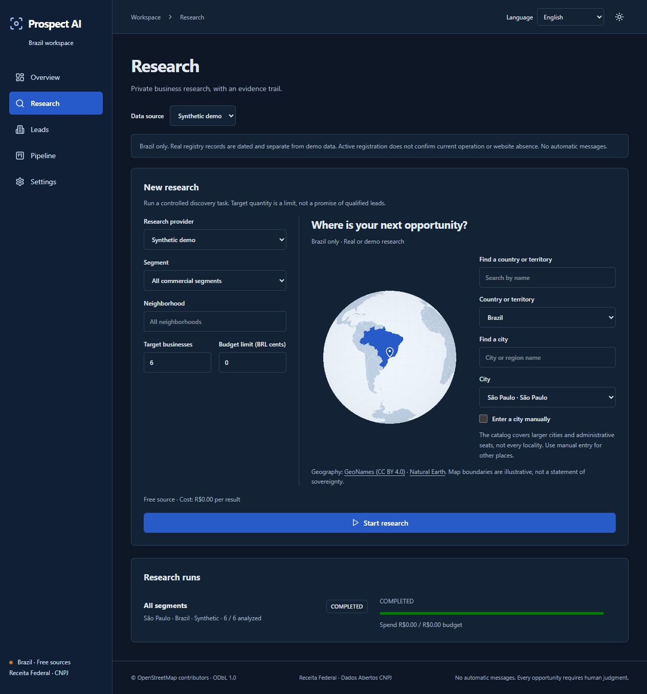
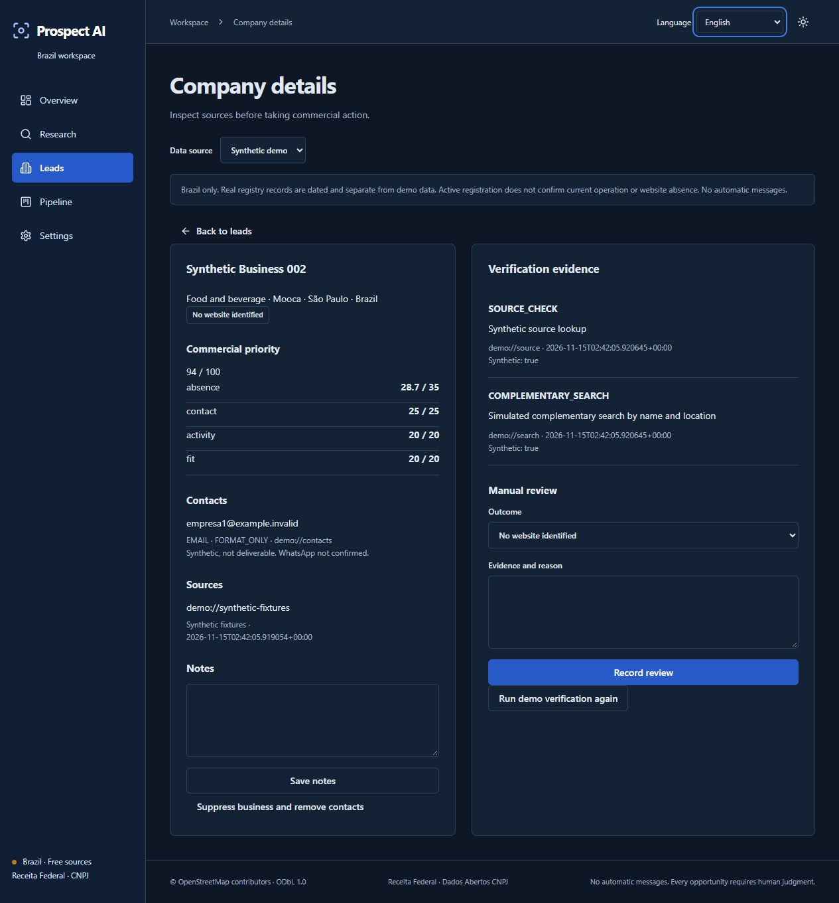
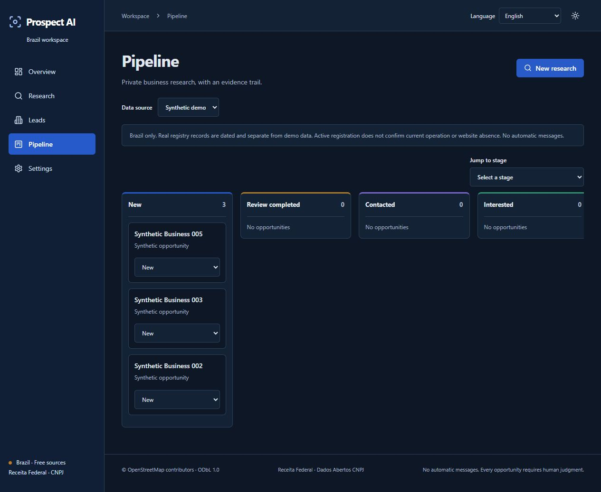
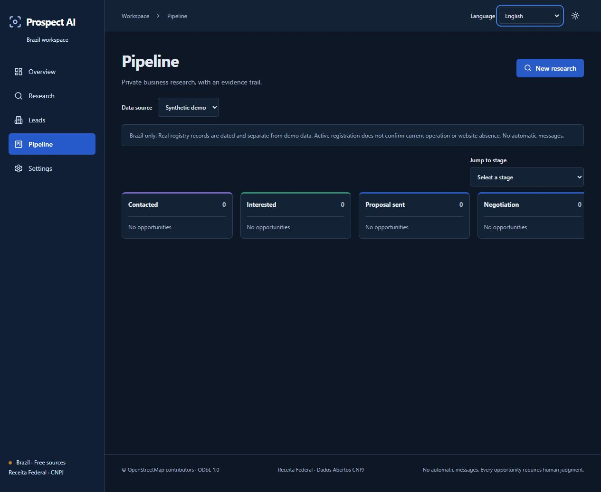
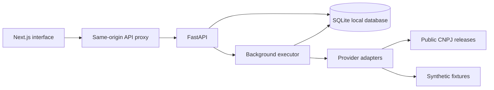

# Prospect AI

**A personal software engineering MVP for researching Brazilian businesses and organizing manual sales opportunities.**

This repository is a public portfolio showcase. It contains documentation and synthetic screenshots; the application source code is maintained separately and is not included here.

## Why I built it

Business prospecting involves finding records, checking their meaning, and tracking follow-up. Prospect AI brings those steps into one workspace, with website-service prospecting as its initial use case.

## Workflow

1. Select a Brazilian municipality, segment, and optional neighborhood.
2. Run a bounded background search using public CNPJ records or synthetic demo data.
3. Review a business, its source, registry snapshot, and available contact provenance.
4. Record manual verification with supporting evidence and notes.
5. Track eligible opportunities through a sales pipeline.

## Screenshots

The screenshots use synthetic data. They do not demonstrate actual customer acquisition, qualified leads, or revenue.

The board scrolls horizontally. Two views show the initial and final stages without shrinking the text. Empty columns are intentional; the demo does not claim completed sales.

## Technology

| Layer | Implementation |
| --- | --- |
| Frontend | Next.js, React, TypeScript, Tailwind CSS |
| UI and forms | Radix UI primitives, Lucide, React Hook Form, Zod |
| API state | TanStack Query |
| Backend | Python, FastAPI, Pydantic |
| Persistence | SQLAlchemy, Alembic, SQLite in the local setup |
| Background jobs | Local executor with progress and pause/resume/cancel controls |
| Geographic interface | WebGL globe, Canvas 2D fallback, D3 Geo, TopoJSON |
| Testing | pytest and Vitest; browser checks tracked separately |

PostgreSQL, Redis, and Celery are included in a separate Docker Compose configuration. Container execution has not been validated in this preparation.

## Engineering decisions

- **Bounded retrieval:** the CNPJ adapter reads limited portions of public establishment archives rather than downloading the national dataset. Results are sampled, not exhaustive.
- **Deduplication:** CNPJ is used to identify establishments and exclude previously imported records on subsequent queries.
- **Traceability:** registry month, collection time, source, and contact validation level are kept separately.
- **Explicit uncertainty:** an active registration does not prove current operation or website absence. Real CNPJ imports require review.
- **Explainable scoring:** scores expose their contributing factors; they do not predict purchase intent.
- **Separate demo data:** synthetic businesses are labelled and separated from real records.

## Architecture

## Validation

See [VALIDATION.md](VALIDATION.md) for the checks performed during portfolio preparation. Historical results are not presented as current verification.

## Limitations

- Research is restricted to Brazil; real queries request at most 50 records.
- Bounded sampling can return fewer records than requested.
- No automated independent website-search provider is configured.
- No LLM inference is configured: **AI is the product name; current scoring is deterministic.**
- No automatic outreach is implemented.
- Real CNPJ exports are disabled in the current implementation.
- The local login-free configuration is for loopback use. Public deployment requires a separate review and authenticated configuration.

## Data sources

- Receita Federal do Brasil: public CNPJ registry releases.
- Natural Earth: map boundaries, public domain, via world-atlas.
- GeoNames: geographic catalogs, CC BY 4.0. Attribution is retained in the application and source package.

## Author

Henrick Feitosa — Software Engineering student at Estácio.

[GitHub](https://github.com/Henrick-feitosa) · [LinkedIn](https://www.linkedin.com/in/henrick-feitosa-b399a8401/)
